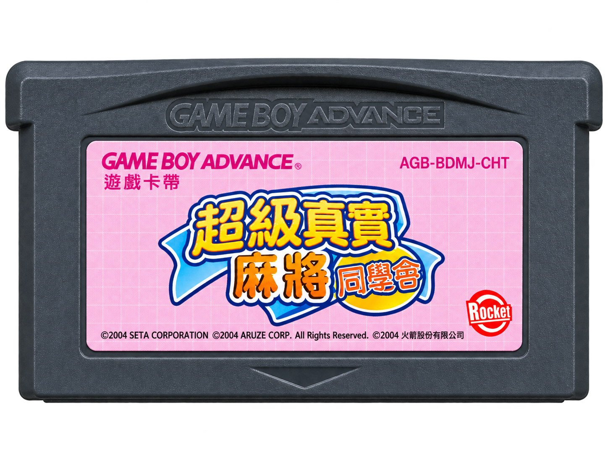
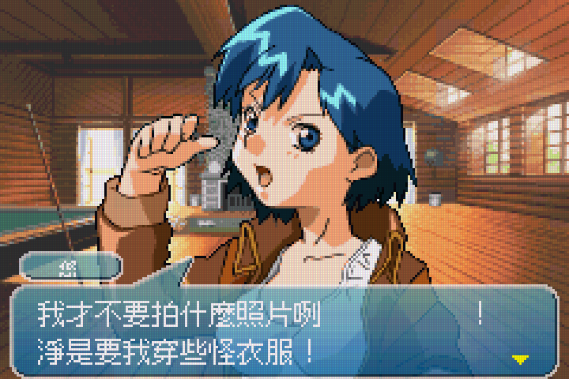
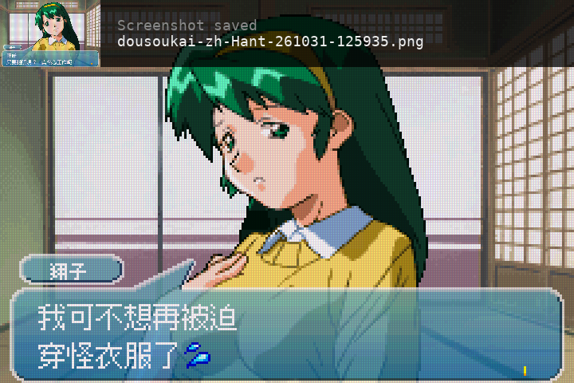
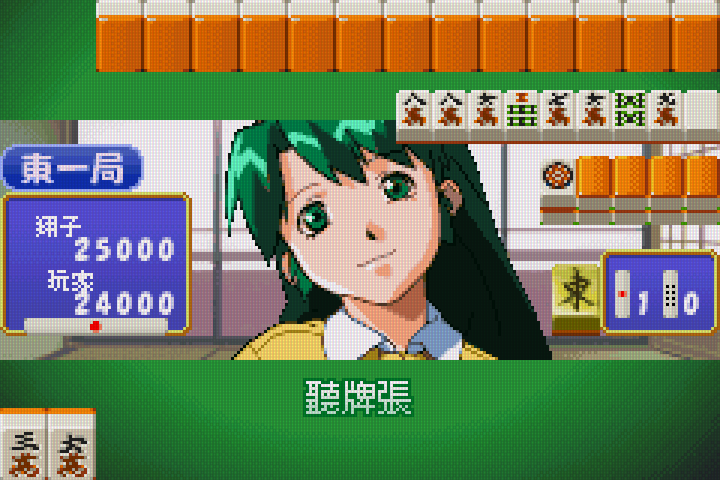
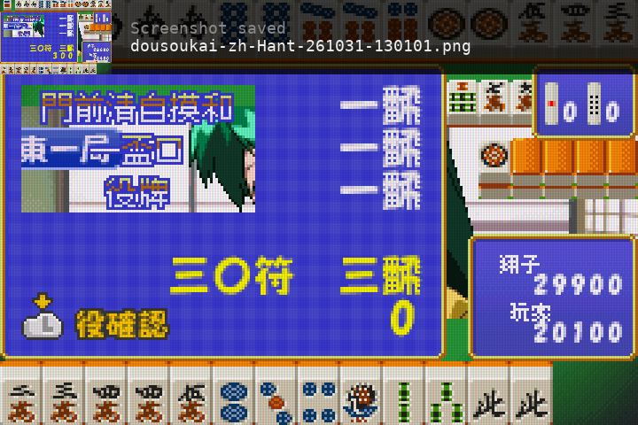

# 超級真實麻將同窗會：繁體中文化




《Super Real Mahjong Dousoukai》（Game Boy Advance 日版）的非官方繁體中文化工具與翻譯資料。

目前為可執行的測試版，**不是完整漢化正式版**。本倉庫提供建置工具、譯文、圖像文字配置與字型，不提供原版或修改版 ROM。請自行準備合法取得、符合下列版本的原始遊戲資料。

## 下載

最新測試版 IPS 補丁：[dousoukai-zh-Hant.ips](https://github.com/yuleshow/GBA-TW-dousoukai/releases/latest/download/dousoukai-zh-Hant.ips)

IPS 補丁僅適用於下方支援的日版 ROM。請參閱[發布頁](https://github.com/yuleshow/GBA-TW-dousoukai/releases)取得版本說明與下載。

## 螢幕擷圖

<table>
  <tr>
    <td></td>
    <td></td>
  </tr>
  <tr>
    <td></td>
    <td></td>
  </tr>
</table>

## 使用

依下方「重建」步驟在本機產生 ROM 與 IPS 補丁，再使用 [mGBA](https://mgba.io/) 開啟產生的 GBA 檔案。
IPS 補丁可用 IPS 工具套用到相同版本的原始日版 ROM；不要套用到 ZIP 壓縮檔或已修改的 ROM。
建置不會修改原始壓縮檔。請勿上傳或散布原始或修改後的商業 ROM。

更新 ROM 後請重新開啟遊戲，勿直接載入舊版本的模擬器即時存檔（save state）。即時存檔會保留舊日文圖塊，即使 ROM 已更新也可能繼續顯示日文；此情況已在 HUD「悠／玩家」重現。請優先使用遊戲內的存檔與「繼續遊戲」，並保留原存檔備份，不必刪除。

## 已處理

- 264 段主要腳本及 50 個額外項目，含實際故事開場、役名和部分測試文字。
- 3,774 個需要翻譯的文字片段；空白、數字及原有特殊圖示另行保留。
- 新增繁體中文字庫，原有日文字形與圖示保留。
- 主選單、部分設定、相簿分類、麻將操作提示、役名及部分結算圖片文字。
- 對話框全部 22 個人名／稱呼標籤、18 位對手 HUD 名稱及「玩家」，使用原生 8 像素繁體字型。
- 對戰順序全部 18 位角色短名，包含克莉絲、悅子、雛子；共用全名圖像的姓氏保持原樣。
- 結算畫面全部 43 個役名修正配色與不透明底色，避免金白混色和背景人物透出；「飜」改為「番」，計分邏輯及數字不變。
- 全部 50 個可見服裝名稱、換裝輪盤／換裝連打標題、發射／停止標籤；保留未解鎖的問號與按鍵圖示。
- 麻將右側全部七個操作：榮和、吃、碰、槓、取消、立直、自摸，保留啟用與停用色彩。
- 續關畫面大標題「要繼續嗎？」，保留倒數人物與底部「按開始鍵續關」。
- 可安全縮短的腳本移除補白；指標不明的配置保留原長度。

翻譯覆蓋率僅適用於已確認的文字集合，不能視為整款遊戲的完成率。

## 尚未完成

- 插畫式日文標題、人物介紹、隊伍徽章及製作名單。
- START 長按提示、部分 HUD、計分單位及其他尚未辨識的圖片文字。
- 少數保留原長度的段落仍有較大的空白或停頓。
- 全路線、全部選項、存讀檔、相簿解鎖及實體卡匣測試。
- 譯文為初稿，短片段受原字數限制，仍需逐場景校對語氣、人名及上下文。

詳細圖像覆蓋清單見 [UI 清單](translations/ui.json)，每次建置也會在本機輸出檢查報告。
新增清單分為 [人名](translations/names-ui.json)、[服裝](translations/costume-ui.json)、[麻將操作](translations/mahjong-ui.json)與[計分單位](translations/scoring-ui.json)，建置會一併載入。

## 重建

需要 Node.js 22 以上與 `unzip`。建置工具使用 Node.js 內建模組，不需要執行 `npm install`；字型及授權文件已包含於倉庫。

```sh
git clone https://github.com/yuleshow/GBA-TW-dousoukai.git
cd GBA-TW-dousoukai
```

將自行準備的日版 ROM 壓縮檔放在以下位置。ZIP 內須包含同名 GBA 檔案；原始 ZIP、解壓檔案與建置產物均由 Git 忽略。

```text
assets/Super Real Mahjong Dousoukai (Japan).zip
```

建置及執行測試：

```sh
node tools/build-rom.mjs
mkdir -p work
unzip -p 'assets/Super Real Mahjong Dousoukai (Japan).zip' \
  'Super Real Mahjong Dousoukai (Japan).gba' \
  > 'work/Super Real Mahjong Dousoukai (Japan).gba'
node --test tools/*.test.mjs
```

建置程式驗證原始 ROM SHA-256、譯文完整性及長度、字形、控制碼、指標、修改範圍和 IPS 還原結果。它會覆寫 build 目錄中的產物，但不修改輸入檔。

```text
build/dousoukai-zh-Hant.gba  繁體中文測試版 ROM
build/dousoukai-zh-Hant.ips  IPS 補丁
build/report.json          建置檢查、覆蓋範圍及限制
build/character-map.json   新增字元對照
build/script-map.json      腳本配置對照
```

目前回歸測試為 51 項通過；另有 1 項需本機 mGBA 測試資料的 HUD 執行測試，預設略過，不屬於一般重建的必要步驟。

### 支援版本

支援的原始 ROM：`BDMJ`，revision `0`，8,388,608 位元組。
以下 SHA-256 對應解壓後的 GBA 檔案，不是 ZIP：

```text
1402fab850ff3cc0b8b25aef1b9673d1e9dc08149ee3be914959ecd1c761e0d5
```

CRC-32：

```text
原版日文 ROM：9E90456B
繁體中文測試版 ROM：0A81BB49
IPS 補丁：8BEBD779
```

## 模擬器驗證

已用 mGBA 0.10.5 核心檢查開機、標題選單、設定頁與故事開場的字形及排版；未完成全遊戲測試。ROM 目前以新增字庫末端結束，非整數 MiB，實體卡匣相容性尚未驗證。
已在最終 ROM 的人物對話確認中文人名。全部服裝、人名與操作圖像通過原始 PAT／SCR 切片重組、字形邊界及非目標像素保留測試；尚未逐一驗證所有角色與換裝小遊戲流程。
新增的對戰順序姓名與結算役名修正已通過圖像重組及成品資料比對，尚未逐場景進行模擬器驗證。

macOS Homebrew mGBA 可用以下命令產生可重現的故事開場截圖，不使用或改寫玩家存檔：

```sh
/usr/bin/clang -isysroot /Library/Developer/CommandLineTools/SDKs/MacOSX26.5.sdk \
  -I/opt/homebrew/opt/mgba/include tools/check-rom.c \
  -L/opt/homebrew/opt/mgba/lib -lmgba -o work/check-rom
work/check-rom build/dousoukai-zh-Hant.gba work/check \
  600:0 1:8 60:0 1:1 300:0 1:1 120:0 1:1 300:0 1:1 180:0
```

SDK 路徑依本機安裝調整。驗證工具的參數為 `影格數:按鍵位元遮罩`，`1` 為 A、`8` 為 START、`0` 為放開按鍵。

## 字型

使用 Fusion Pixel Font 12px 與 8px monospaced zh_hant，版本 2026.09.01。
詳見 [字型來源](assets/fonts/README.md)與 [SIL Open Font License](assets/fonts/OFL.txt)，建置時會檢查字型雜湊。字型授權不涵蓋原遊戲內容。

## 回報問題

請在 [GitHub Issues](https://github.com/yuleshow/GBA-TW-dousoukai/issues) 提供角色、場景、重現步驟、模擬器版本及使用的提交版本，並註明是否載入舊即時存檔。文字或排版問題可附截圖；請勿附上 ROM 或原始遊戲壓縮檔。

本專案與原遊戲權利人無關，遊戲名稱、角色及原始素材的權利歸各自權利人所有。